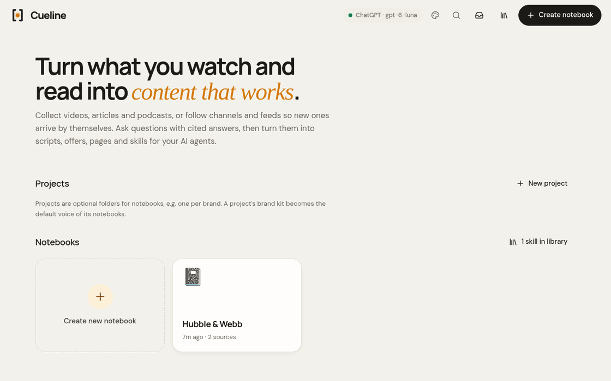
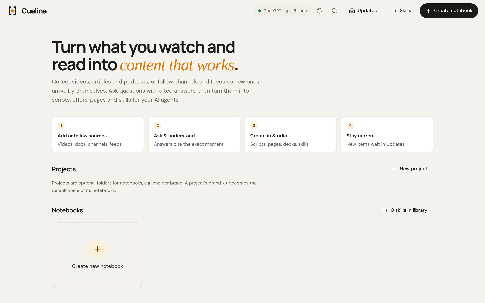
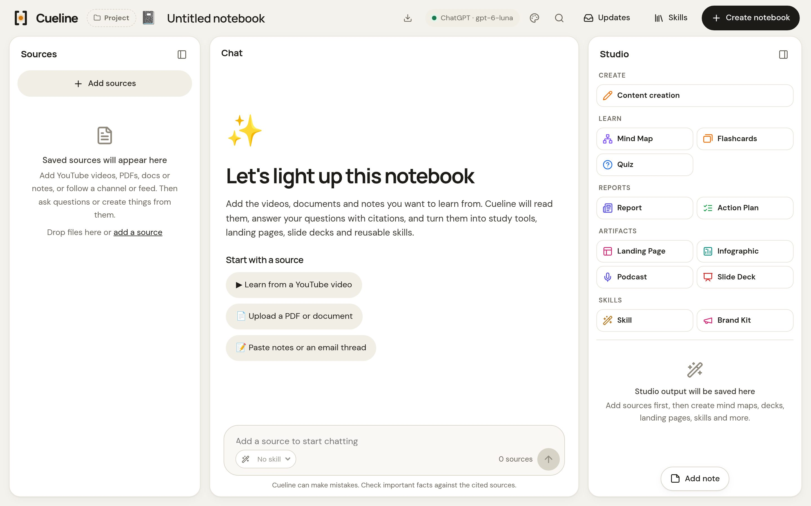

<h1 align="center">Cueline</h1>

<p align="center"><b>Your feeds in, cited content out.</b><br>
An open-source NotebookLM for creators. It follows the YouTube channels, blogs and podcasts you learn from<br>
and turns them into posts, scripts, landing pages, podcasts and agent skills.<br>
Every claim links to the second it was said.</p>

<p align="center">
  <a href="https://github.com/ghost-mb/cueline/actions/workflows/ci.yml"></a>
  
  
  
</p>



Two NASA videos in, then a cited answer, a LinkedIn post and an agent skill out. More outputs (a newsletter too) are in
[`examples/`](examples/), unedited, with timestamps you can click.

## Why Cueline

Research notebooks wait for you to feed them. Cueline goes and gets it:

- **Sources arrive by themselves.** Follow a YouTube channel, playlist or search, a blog, newsletter or podcast.
  New items land in an inbox with a summary, a fit score and three content ideas.
- **Every claim is traceable.** Answers and drafts cite the exact passage or timestamp; a built-in checker (no AI)
  flags quotes and citations that don't match the source. Missing facts become placeholders, never inventions.
- **It makes things you publish, not just notes.** Short and long video scripts, posts, carousels, threads,
  newsletters, articles, landing pages, slide decks, podcasts with two hosts, infographics, in your brand's voice.
- **It teaches your agents.** Turn any notebook into a `SKILL.md` and install it into Claude Code or Codex in one click.
- **It stays on your laptop.** Your library, keys and outputs live in `~/.cueline`. No account, no server, and Cueline itself sends no telemetry.

## Quickstart

Open a terminal and paste two lines. The first installs [uv](https://docs.astral.sh/uv/), a small Python installer
that also fetches a compatible Python for you.

**macOS or Linux** (Terminal):

```bash
curl -LsSf https://astral.sh/uv/install.sh | sh
uv tool install git+https://github.com/ghost-mb/cueline
```

**Windows** (PowerShell):

```powershell
powershell -ExecutionPolicy ByPass -c "irm https://astral.sh/uv/install.ps1 | iex"
uv tool install git+https://github.com/ghost-mb/cueline
```

Then start it (open a new terminal first if `cueline` isn't found):

```bash
cueline
```

Open **http://127.0.0.1:8790**. On first start Cueline asks which AI to use:

| AI | What you need |
|---|---|
| **Your ChatGPT plan** | OpenAI's [Codex CLI](https://github.com/openai/codex): `brew install --cask codex` (Mac) or `npm install -g @openai/codex`, then run `codex` once and choose **Sign in with ChatGPT**. No API bill. |
| **Claude, OpenAI, Gemini, OpenRouter** | Paste an API key in the app. It is stored only on your computer. |
| **A local model** | [Ollama](https://ollama.com) or [LM Studio](https://lmstudio.ai) running on your computer. Nothing leaves your machine. Small models write weaker drafts than the big cloud ones. |

Podcasts and audio transcription run on your computer too. Add them with the `audio` extra (+~400 MB):

```bash
uv tool install --force "cueline[audio] @ git+https://github.com/ghost-mb/cueline"
```

## What's inside





| | |
|---|---|
| **Sources** | YouTube videos (captions, or the audio transcribed locally when there are none), web pages and blog posts, PDF/DOCX/TXT/MD, audio files and podcast episodes (transcribed locally), pasted text, other notebooks |
| **Live sources** | YouTube channels, playlists and searches, RSS/Atom blogs, newsletters, podcasts. Checked every 6 hours. |
| **Chat** | Streaming answers grounded only in your sources, with clickable citations that open the exact passage or moment |
| **Studio** | Content creation (8 formats × 5 tones, fact check under each piece), landing page, slide deck, podcast, infographic, report, mind map, flashcards, quiz, skill, brand kit. Refine any output by chat; versions are kept. |
| **Brand kits** | Projects hold a brand kit (its voice, offers and phrases) that every notebook inside writes in |
| **Skills** | A library of `SKILL.md` files: write, version, preview, import from your agents, install into `~/.claude/skills` and `~/.codex/skills` |
| **Agent CLI** | `cueline notebooks`, `cueline new`, `cueline add <notebook> <url or file>`, `cueline ask <notebook> "question"` |

## Privacy and safety

- The server listens on `127.0.0.1` only and refuses other host names.
- Sources are treated as untrusted data. The ChatGPT/Codex engine runs with every tool turned off (no shell, files,
  web or MCP servers), in an empty folder.
- Generated web pages render in a sandboxed frame: they can't reach Cueline, your files or
  your network. They may load fonts and code libraries from public CDNs (Google Fonts, cdnjs, jsDelivr).
- Feeds and web pages are only fetched from public internet addresses, never your computer or local network. The address
  is checked at the moment of connecting, so DNS tricks (rebinding) can't redirect a fetch. Capped at 5 MB.
- Installing a skill is the only write outside `~/.cueline`, and it always asks first (with a diff and a backup).

## Updating

```bash
uv tool upgrade cueline
```

Your data in `~/.cueline` is kept, and the database updates itself on the next start.

## Settings

Environment variables, all optional:

| Variable | Default | |
|---|---|---|
| `CUELINE_DATA` | `~/.cueline` | Database, keys, models, backups |
| `CUELINE_WATCH_HOURS` | `6` | How often live sources are checked |
| `CUELINE_FEED_DAILY_CAP` | `30` | New items the AI reads per day |
| `CUELINE_AUTO_ADD_DAILY_CAP` | `10` | Items auto-added as sources per day |
| `CUELINE_STT_MODEL` | `base` | Local speech-to-text model (faster-whisper) |
| `CUELINE_VOICE_SPEED` | `1.2` | Podcast voice speed (local voices) |
| `CUELINE_CLAUDE_SKILLS_DIR` / `CUELINE_CODEX_SKILLS_DIR` | `~/.claude/skills` / `~/.codex/skills` | Where skills install |
| `CUELINE_CODEX_BIN` | `codex` | Path to the Codex CLI |
| `CUELINE_LOCAL_URL` | `http://localhost:11434/v1` | Local model server (Ollama; LM Studio: `http://localhost:1234/v1`) |

Run on another port with `cueline --port 9000`.

## Development

```bash
git clone https://github.com/ghost-mb/cueline && cd cueline
uv run --extra audio cueline                                    # run from source
uv run --extra audio python -m unittest discover -s tests       # unit tests (AI, voices and network are mocked)
python3 tools/fresh_install_check.py                            # install like a new user, run every flow on a fake AI
```

The code is one Python package (`src/cueline/`: Flask server, SQLite, vanilla JS with no build step). See [CONTRIBUTING.md](CONTRIBUTING.md) for where things live and the ground rules.
On Linux, `scripts/cuelinectl start|stop|status|logs` keeps it running in the background as a systemd user job.

## FAQ

**How is this different from NotebookLM?** NotebookLM is free, polished and hosted by Google. Cueline is open source
and runs on your computer with the AI you choose. It also follows channels and feeds for you, writes publishable
formats (scripts, posts, landing pages) in your brand's voice, checks every citation, and turns notebooks into skills
for your coding agents.

**Is using my ChatGPT plan allowed?** Cueline runs OpenAI's official Codex CLI on your computer with your own login,
with all of Codex's tools turned off, so usage counts toward your plan's Codex limits just like using Codex directly.
Check OpenAI's terms for your plan. An API key or a local model are the alternatives.

**Does my data leave my computer?** Your library stays in `~/.cueline`. The text of the sources you use is sent to
the AI you picked (none if you use a local model), and Cueline fetches the videos, pages and feeds you add.

## Limits

- **Scanned PDFs** (images of text) can't be read: there's no OCR.
- **Updates inbox:** new videos without captions get no AI summary there. Added to a notebook, they're transcribed
  on your computer (with the `audio` extra).
- **Local transcription** uses a small, fast speech model that sometimes mishears words.
  `CUELINE_STT_MODEL=small` is more accurate but slower.
- **Very large notebooks** (over ~360k characters of sources) use keyword search to pick passages, so an answer can
  miss a passage that uses different words.
- **Speed and usage** come from your AI plan or key: chat answers take 2-10 seconds, Studio outputs 1-2 minutes.

## License

[MIT](LICENSE)
